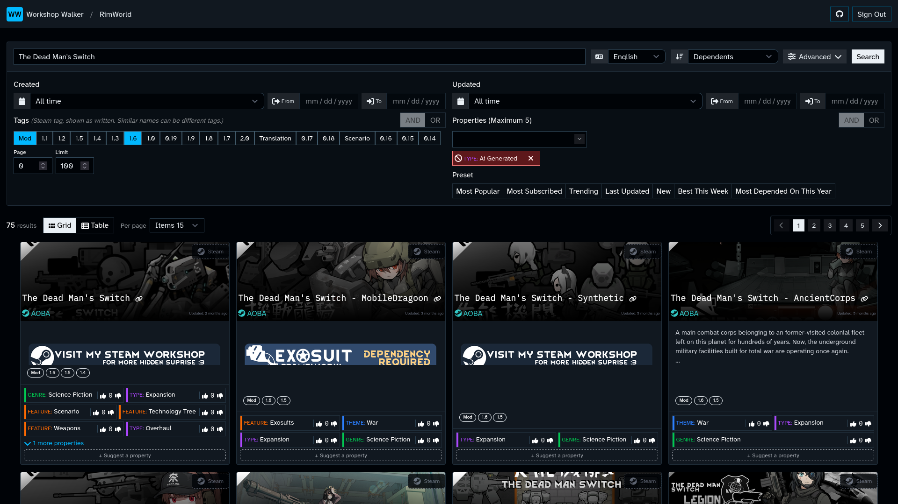
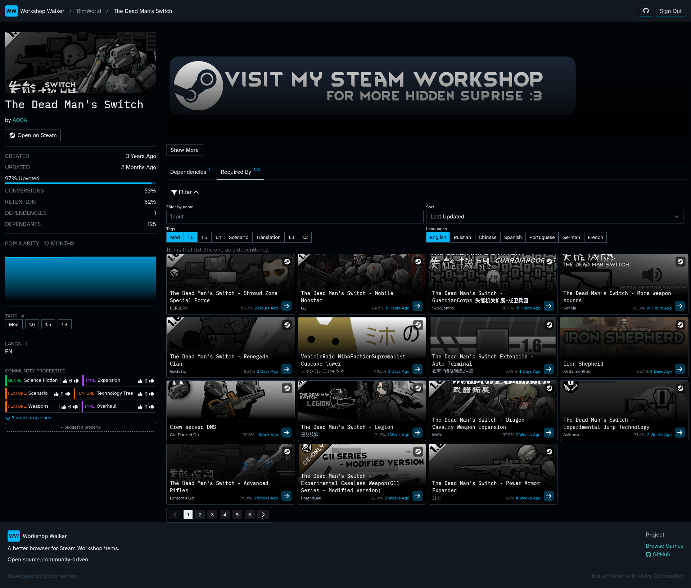

# Workshop Walker

[](https://github.com/disconsented/workshop-walker/releases)
[](https://github.com/disconsented/workshop-walker/actions/workflows/rustfmt.yml)
[](https://github.com/disconsented/workshop-walker/actions/workflows/ui.yml)
[](LICENSE.md)
[](https://conventionalcommits.org)

---

## About

Workshop Walker is an alternate interface to the Steam Workshop, making it easier to find the items you care about.

It does this by taking the data freely provided by Valve, analysing it and serving it up in a tidy package.

Specific improvements:

- Dependant discovery, find everything that depends on this item.
- Language detection, filter for specific languages. No more poorly marked translations.
- Properties, extended classification, submit new ones or vote on existing entries for relevance.

Interested? You can check it out live at https://workshop-walker.disconsented.com/

## Screenshots

### Search



### Item Page



## How it works

Workshop Walker pulls every item from the Steam Workshop periodically via their API, processing each item individually for the following:

- Language detection on the item's body.
- Converting BB Code to HTML for rendering.
- ML assessments for properties if the description has changed.
- Inserting relationships between items. This is something
  that [SurrealDB lets us model cleanly](https://surrealdb.com/docs/reference/query-language/statements/relate).

## Suggest a Game

This project was created for RimWorld originally, however it is designed to be agnostic and work with any Steam Workshop
game.

If you think that it'd be useful to include, please
open [a new discussion](https://github.com/disconsented/workshop-walker/discussions/new?category=game-suggestions).

Please do take care to explain how Workshop Walker will be useful, I'd rather not add games that won't benefit or won't get used.

## Contributing

Want to contribute a feature? Great!

Please suggest it as an _issue_ to get a feeling on whether I'll accept it. Remember, that every piece of code
contributed adds to the maintenance burden. This is also an effort to manage burnout.

For anything touching the UI, ideally include some kind of visual reference.

If it's accepted:

- Commit messages follow [Conventional Commits](https://www.conventionalcommits.org/). release-plz builds the changelog and version from them.
- Rust: `cargo +nightly fmt --all` and `cargo clippy --all` must pass. Clippy warnings fail the build.
- UI: `npm run format`, `npm run lint` and `npm run check` from `ui/` must pass.

## Getting Started

### Requirements

- Rust, latest stable
- Clang, to build RocksDB (`libclang-dev` on Debian and Ubuntu)
- Node.js 26
- [biscuit-cli](https://doc.biscuitsec.org/usage/command-line.html), to make a keypair
- A [Steam Web API key](https://steamcommunity.com/dev/apikey)
- a llama.cpp server for property classification 

The database is embedded. It writes to `./workshopdb` and needs no server.

### Configure

  ```bash                                                                                                                                                                                                 
  git clone https://github.com/disconsented/workshop-walker                                                                                                                                               
  cd workshop-walker                                                                                                                                                                                      
  cp config/config.example.toml config/config.toml                                                                                                                                                        
  biscuit keypair                                                                                                                                                                                         
  ```    

Put the keypair, your Steam API key and your SteamID64 in `config/config.toml`.                                                                                                                         
To run without classification, set `ml_extraction.enabled = false`.

### Classifier (optional)

  ```bash                                                                                                                                                                                                 
  docker run -d -p 8081:8080 \                                                                                                                                                                            
    --volume models:/models --env LLAMA_CACHE=/models/ \                                                                                                                                                  
    --restart unless-stopped \                                                                                                                                                                            
    ghcr.io/ggml-org/llama.cpp:server \                                                                                                                                                                   
    -hf google/gemma-4-E4B-it-qat-q4_0-gguf -hff gemma-4-E4B_q4_0-it.gguf \                                                                                                                               
    -c 4096 -np 1 -t 20 -tb 20 --jinja --reasoning off \                                                                                                                                                  
    --sleep-idle-seconds 120 --no-warmup                                   
   ```

### Run

Backend (listens on port 5800):

```bash
RUST_LOG="workshop_walker=debug,salvo=debug" cargo run --bin workshop-walker
```

Frontend, in a second terminal:

```bash
cd ui
npm install
npm run dev
```

Open http://localhost:5173. The dev server sends `/api` to the backend.
--- 

This project is not associated with Valve, Steam, etc. I just got annoyed one day I couldn't see dependants and wanted an
excuse to use SurrealDB relations.